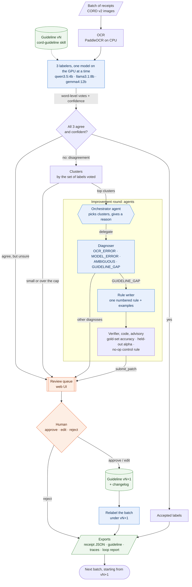

# Rulebook

Rulebook is an agentic labeling system. Three small local models label shop receipts. When they disagree,
agents work out why, draft a new rule for the labeling guideline, measure it against a gold set,
and send it to a human. If the human approves, the guideline gets a new version, the batch is relabeled under it,
and the loop moves to the next batch.

It runs **fully offline** on one consumer GPU (Ollama, OpenAI-compatible endpoint) and uses
[CORD v2](https://huggingface.co/datasets/naver-clova-ix/cord-v2) receipts (Indonesian shops). The
agent harness is written from scratch: no LangChain, LangGraph, CrewAI or similar.

`SPEC.md` is the design; `DECISIONS.md` logs every decision; `PROGRESS.md` holds the status and
the known issues.

## What it does



Blue: model agents. Orange: the human's part. Green: stored artifacts. Every decision the
orchestrator makes, and every tool call, goes into a JSONL trace you can browse in the UI.

- **Labeling unit:** words. Each OCR line is shown with numbered words; a labeler returns spans
  `{line_idx, words, label, confidence, reason}`. The JSON schema per line is enforced by Ollama, and
  missing words get one targeted repair. Labels are CORD's 29 categories plus `other`.
- **Numbers are parsed in code** (`rulebook/tools/receipt.py`), never by a model. Indonesian
  formats (`12.500`, `2.000,00`, `Rp`) are read per token, with "ambiguous" instead of a guess. A receipt
  sum check flags suspicious lines.
- **No leakage:** agents, tools, prompts and skills never see v2 labels. Only `eval/` reads them,
  after a run. The verifier reaches the 30-receipt gold set (validation split) through one
  sanctioned function. A test enforces both rules.
- **Human in the loop:** `apply_patch` and `relabel` are `needs_approval` tools. The run blocks
  on a `QueueApprover` until someone decides in the UI (or on a `CLIApprover` in a terminal).

## Architecture

| Part | Where | What |
|---|---|---|
| Harness | `rulebook/harness/` | `model.py` (OpenAI-compatible client, retries, JSON fallback for tool calls, VRAM guard), `tools.py` (pydantic-typed tools, truncation, approval gate), `loop.py` (agent loop, structured output, one repair, forced answer at max steps), `skills.py` (SKILL.md files, `load_skill`), `context.py` (token budget, compaction), `guard.py` (CLI and queue approvers), `orchestrator.py` (`delegate`), `trace.py` (JSONL audit log), `memory.py` (VRAM check: one model at a time) |
| Agents | `agents.yaml` | labelers a/b/c, diagnoser, rule writer, orchestrator. Models and thresholds are in `config.yaml` |
| Skills | `skills/` | `cord-guideline` (the current guideline version), `disagreement-taxonomy`, `guideline-style` |
| Tools | `rulebook/tools/` | OCR, number parsing and sum check, labeling schema, clustering, agent tools, guideline versions, stats, verifier |
| Pipeline | `rulebook/pipeline/` | `labeling.py` (batch labeling), `improve.py` (cluster → diagnose → write → verify stages), `orchestrator_agent.py` (the LLM orchestrator), `orchestrate.py` (the loop), `exports.py` |
| API + UI | `rulebook/api/app.py`, `web/` | FastAPI + React (Vite): dashboard, review queue, trace viewer |
| Eval | `eval/` | the only code that reads v2: labeling reports, the all-agree-but-wrong breakdown |

## How to run

Needs Python 3.12 with Poetry, Node 20+, and Ollama with the models in `config.yaml`
(`ollama list`). Everything runs locally.

Install:

```bash
poetry install
```

```bash
npm --prefix web install
```

```bash
npm --prefix web run build
```

Start the UI and API at <http://localhost:8000>:

```bash
poetry run uvicorn rulebook.api.app:app --port 8000
```

From the dashboard, start a loop (batch size, offset, number of clusters, orchestrator
`agent` or `code`). When it needs a decision it waits in the **Review queue**. The same loop can be run
from the terminal, with approvals at the prompt:

```bash
poetry run rulebook loop --batch-size 10 --offset 60 --max-clusters 2 --approver cli
```

Other commands: `rulebook run` (label one batch), `rulebook improve RUN_ID` (one improvement
round on a labeled run), and `python -m eval.labeling_report RUN_ID` (scores against v2, after a run).
Before calling anything done:

```bash
poetry run ruff check . && poetry run pytest
```

## Results (real runs, dev receipts only)

All numbers come from runs in `reports/` and `exports/`. Dev runs use the first N train receipts;
nothing here touches the test split. "Headline" is agreement with v2 over CORD-matched words,
counting `other` on a matched word as wrong.

**Labelers, guideline v1** (word-level Krippendorff's alpha across the 3 labelers):

| run | text | receipts | alpha | qwen3.5:4b | llama3.1:8b | gemma4:12b |
|---|---|---|---|---|---|---|
| `20261108-164513-9af69a` | gold (CORD's own words) | 20 | 0.745 | 75.3% | 83.2% | 90.5% |
| `20261108-162007-4ac31b` | OCR | 50 | 0.593 | 55.7% | 62.3% | 75.4% |

- On the 50-receipt OCR run, all 3 labelers agree on 560 words, and those match v2 85.4% of the
  time. On gold text it is 98.0%.
- Of the 82 all-agree-but-wrong OCR words, 12 are OCR misreads and **70 are shared mistakes**
  (same text, same wrong label). The top pair is `menu.cnt` labeled `menu.nm` (20 words).
- OCR costs a lot. On 20 receipts, alpha drops from 0.714 (gold text) to 0.620 (OCR); 7–11% of OCR
  words have no matching CORD word.

**One full loop from the UI** (`loop-20261109-050622`, train_0050–0059, OCR, top 2 clusters):

| stage | seconds |
|---|---|
| label 10 receipts × 3 models | 269 |
| diagnose 2 clusters | 39 |
| write 2 rules | 12 |
| verify (gold set × 3 labelers, plus control) | 1,676 |
| relabel under v2 | 242 |

| | before (v1) | after (v2) |
|---|---|---|
| word-level alpha | 0.587 | 0.621 |
| headline: qwen / llama / gemma | 57.4 / 53.4 / 68.2% | 56.1 / 60.1 / 68.6% |
| majority vote matches v2 | 70.1% | 72.8% |
| all-3-agree matches v2 | 74.8% | 77.9% |
| the patched cluster's words: majority correct / all agree | 6/7, 0/7 | 7/7, 4/7 |

The human rejected rule 1.7 (verifier: fail) and approved rule 3.8 (verifier: pass; gold-set
accuracy 0.585 → 0.593; held-out cluster alpha −0.11 → 1.00). Rule 3.8 says: a "CASH"/"TUNAI"
line without an amount, with the amount on the next line, labels both lines `total.cashprice`.
**Caveat:** the after numbers come from the same 10 receipts the rule was written from, and 10
receipts is a small sample. Treat this as "the loop works end to end", not as a measured gain.

**The orchestrator agent, live** (`loop-20261109-062540`, train_0060–0069, OCR, may handle 2
of 4 open clusters). In 10 steps it listed the clusters and picked the two largest. It ran
diagnoser → rule writer → verifier → `submit_patch` on each, giving a reason for every call
(see the trace viewer, agent `orchestrator`), then reported. Both drafted rules passed the
advisory verifier. Rule 3.9 (a "CHANGE"/"KEMBALI" line, amount on the next line → both
`total.changeprice`) moved gold-set accuracy 0.593 → 0.630, while the no-op control moved it
0.593 → 0.588. Rule 1.7 (truncated item names → `menu.nm`) moved it 0.593 → 0.598. The human
approved both (guideline v4) and the relabel. Stage times: diagnose 43 s, write 11 s, verify 2,378 s.
On those same 10 receipts (in-sample), v2 → v4: alpha 0.651 → 0.650, majority vote 76.6 → 77.9%,
all-3-agree 84.6 → 87.4%, words sent to review 41.6 → 38.6%.

## Limitations (honest list)

- **OCR-mode accuracy is modest.** Majority vote matches v2 on about 70–76% of words on OCR
  text (91% on clean text), and single labelers score 54–78% headline. 7–11% of OCR words have no
  CORD word to match, and the OCR-to-CORD word matching has errors (e.g. `B` → `20.000`).
- **Verifier noise is as big as the effects.** A no-op rule ("read each line in full") moved gemma's
  gold accuracy by −5.4 points and qwen's by +3.7. Patches move gold by a few points, so the
  verifier's pass/fail is advisory and a human decides. Held-out samples are tiny (2–9 words).
- **The diagnoser hits its step limit.** After the tool-argument fix (0 tool errors, down from
  dozens), 7 of 8 diagnoses on the 50-receipt run still use all 12 steps and are forced to answer
  (2 of 2 in the orchestrator run).
- **Shared mistakes the loop can't see.** The loop only looks at disagreements. 70 of the 82
  all-agree-but-wrong OCR words are the same wrong label from all three models (top:
  `menu.cnt` → `menu.nm`, 20 words), so no cluster ever forms for them.
- **The loop is tested on small batches only:** two live loops of 10 receipts each, and one
  50-receipt generalization check.
- The orchestrator does not call `skip_cluster` for clusters it leaves; those go to the review
  queue as "not handled by the orchestrator".

## Next steps

1. An inference page: upload a receipt, get labeled JSON back.
2. Enforce a 3-inspection cap for the diagnoser in its tools.
3. UI renames: "gold text" → "clean text", "gold set" → "verification set".
4. A chunk-size ablation (the 20-line chunks have never been tested on their own).
5. A vision re-read agent for OCR lines nobody can read.
6. Larger runs.
